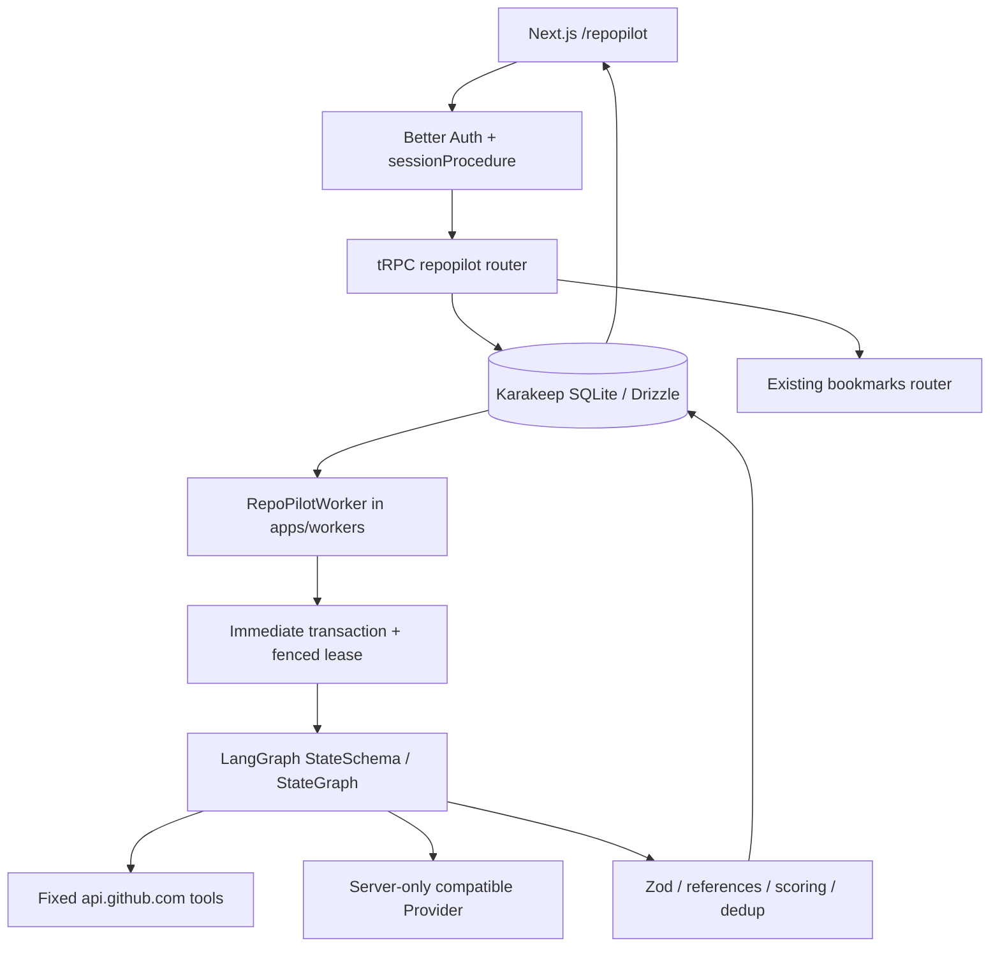
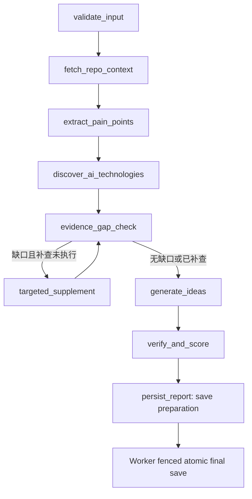

# RepoPilot 实际架构

## 组件与数据流

实际路径：

| 边界 | 文件 |
| --- | --- |
| 登录及导航复用 | `apps/web/server/auth.ts`、`apps/web/app/dashboard/layout.tsx` |
| 页面及客户端交互 | `apps/web/app/repopilot/**`、`apps/web/components/repopilot/**` |
| tRPC + owner 校验 | `packages/trpc/routers/repopilot.ts`，注册于 `_app.ts` |
| 共享输入/报告/导出类型 | `packages/shared/repopilot/{input,report,types}.ts` |
| 表与迁移 | `packages/db/schema.ts`、`packages/db/drizzle/0095_repopilot_research.sql` |
| Agent、Provider、GitHub、校验器 | `packages/shared-server/src/repopilot/**` |
| 后台任务 | `apps/workers/workers/repopilotWorker.ts`，在 `apps/workers/index.ts` 注册 |
| 本地启动/测试入口 | `scripts/repopilot-*.mjs`、`scripts/repopilot-live-smoke.ts` |

未新建独立服务、数据库、Redis 或 Python 组件。共享类型不依赖服务器，UI 不导入 Provider。shared-server 依赖 shared/db；trpc 与 workers 调用 shared-server。

## 持久化与恢复

- `repopilot_research_runs`：owner、仓库、配置、状态、阶段、进度、快照、报告、轨迹、模式、错误、收藏关联、usage、时间、attempts 和 lease。
- `repopilot_evidence`：run 外键、来源类型/URL/标题/有限摘录、外部 ID、来源仓库、时间、状态/发布日期元数据。
- `repopilot_feedback`：用户/run/机会唯一组合，评价与采纳。
- `repopilot_events`：仅 run、事件名称、时间，用于本地统计；无第三方分析服务。

run/evidence/feedback/events 删除联动。收藏删除时研究的 bookmarkId 置空。研究 owner 删除时研究删除。历史使用 `(createdAt,id)` 游标。

现有 Liteque 位于独立 `queue.db`，无法与研究创建共享事务。为避免“双写时任务已建但未入队”，采用任务表即队列：创建只写同一 DB；worker 用 immediate transaction 抢占一条，租约为最大研究时限 + 15 秒。每次更新与终态保存检查随机 leaseToken 和 running 状态。租约过期重新排队，最多三次执行，之后 failed。SQLite 部分唯一索引保证每用户只有一个 active run。重试创建新 run，不混入旧报告。默认每个 worker 一次一个任务。

进程崩溃恢复会从图起点重跑，不做节点级断点续传；一次失败可能损失已经消耗的外部额度。旧进程无法覆盖新租约。删除正在执行的任务后，下一次状态更新会失去租约并终止；外部已发送请求无法撤回。

## 图与停止条件

LangGraph `StateSchema` 包含 typed context：repo/profile、来源、痛点、技术候选、模型工具计划、缺口、次数、候选报告、最终报告、警告及轨迹。节点记录名称、耗时、成功/失败和请求增量，不记录内部推理或完整 prompt。持久化终态由 worker 在图返回后原子保存，图中的保存节点完成 schema 终检。

主仓库：README ≤20,000 字符；issue ≤100，最多 5 页，剔除 PR、按 ID 去重、正文 ≤1,200；release ≤10；根目录前 50 个条目。不下载执行代码。相关项目最多 3 个，读取元数据、README 和最多 5 条 release。模型选择搜索词及 issue/readme/releases/search 补查工具，最多一轮。当前 issue 补查最多一条，属于规范允许的最多五条之内。

GitHub 总请求 ≤24（分页/重试均计数）；模型 ≤5 次，schema 不合规最多重试一次，每次输出 ≤5,000 tokens；累计输入使用 ≤300,000 UTF-8 字节的保守预算，并不伪称实际 tokenizer 统计。总时限 ≤180 秒，HTTP abort + worker 超时竞争确保任务收敛。流式响应设大小上限，拒绝自动跳转。

## 安全及可信度边界

- 每个 tRPC query/mutation 验证用户归属，拒绝 API Key 访问研究接口。原书签逻辑仍处理权限、配额和后续任务。
- GitHub 主机固定，先检查仓库公开性；不执行任何目标仓库代码；模型只能返回白名单结构化工具参数。
- 外部内容用独立 JSON 数据块传入，系统提示不接受其中的指令；模型从未得到 API Key。模型正文仍可能产生错误，应人工复核。
- 服务端重建 references，不接受模型生成 URL。痛点样本去重，未知 ID 移除，无引用结论标为假设。验证来源存在不等于验证语义蕴含。
- 分数 schema 限界，总分程序重算。证据不足降置信度/分数；技能或周期不匹配增加风险。去重采用相同痛点/标题与文本相似度启发式，不承诺完美语义去重。
- React 输出普通文本，不注入 HTML；Markdown 转义文本，引用 URL 只接受官方 GitHub HTTPS。
- Mock transport 只读录制夹具，无网络 fallback；元数据与证据使用录制时间。完整离线启动仅启用研究 worker，原收藏抓取任务排队。
- usage 仅在所有响应均提供 usage 时显示总量；无价格表，cost 始终空。

原版搜索依赖 Meilisearch，浏览器抓取依赖原 crawler 网络环境；两者与研究图的原生 fetch 分开，当前环境限制见 TEST_REPORT。
